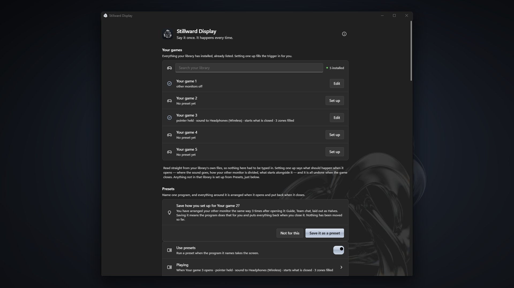

  

<h1 align="center">Stillward Display</h1>

  <b>Say it once. It happens every time.</b> 
  A window and display manager for PC gamers on Windows.

  <a href="https://store.steampowered.com/app/5248400/Stillward_Display/">Steam</a> ·
  <a href="https://stillwarddisplay.com">Website</a> ·
  <a href="https://github.com/ayokiru/stillward-display/issues">Report a bug</a> ·
  <a href="CHANGELOG.md">Changelog</a>

---

**Status:** coming soon on Steam. [Wishlist it](https://store.steampowered.com/app/5248400/Stillward_Display/)
to hear when it is out.

This repository holds no source code. It is where releases are announced, bugs
are reported and ideas are collected.

## Reporting a bug

1. Open Stillward Display → **Diagnostics** → **Run the diagnostic** → **Copy report**.
2. [Open an issue](https://github.com/ayokiru/stillward-display/issues/new/choose)
   and paste the report in.

Issues here are public, so read the report through before posting. If you would
rather not post it, write to **support@stillwarddisplay.com**.

---

Stillward Display is proprietary software by ayokiru.
