<p align="center">
  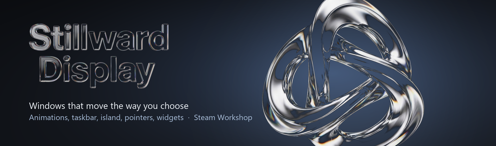
</p>

<p align="center">
  <a href="https://store.steampowered.com/app/5248400/Stillward_Display/"></a>
  
  <a href="https://steamcommunity.com/app/5248400/workshop/"></a>
  
  
</p>

<p align="center">
  <a href="#what-it-does">What it does</a> &nbsp;·&nbsp;
  <a href="#animations">Animations</a> &nbsp;·&nbsp;
  <a href="#make-your-own">Make your own</a> &nbsp;·&nbsp;
  <a href="#made-without-injection">Safe to use</a> &nbsp;·&nbsp;
  <a href="#updates">Updates</a> &nbsp;·&nbsp;
  <a href="https://stillwarddisplay.com">Website</a>
</p>

Stillward Display changes how Windows moves and looks. Pick how a window
minimizes, opens, closes, snaps or moves to another screen. Put a dock or a
taskbar of your own at the bottom and an island at the top, change the pointer,
lay widgets on the wallpaper. Every look can be shared on the Steam Workshop,
and every one is a file you can make yourself.

It works from its own process: no code goes into other programs, and
everything it changes goes back when you turn it off.

<table>
  <tr>
    <td width="33%"></td>
    <td width="33%">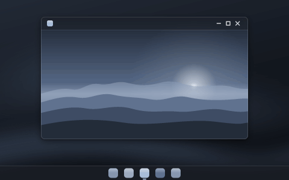</td>
    <td width="33%">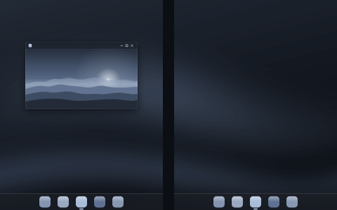</td>
  </tr>
  <tr>
    <td><b>Lamp</b>, minimize</td>
    <td><b>Burn</b>, close</td>
    <td><b>Hourglass</b>, to another screen</td>
  </tr>
</table>

## What it does

<table>
  <tr>
    <td width="33%" valign="top">
      <br>
      <b>Window animations</b><br>
      A style for every moment: minimize, open, close, maximize, snap, drag, resize, a move to another screen, a desktop switch. Windows' own until you pick.
    </td>
    <td width="33%" valign="top">
      <br>
      <b>Taskbar and dock</b><br>
      A dock that magnifies under the pointer, or a taskbar of its own made of glass islands. Apps, search and a control centre you lay out yourself.
    </td>
    <td width="33%" valign="top">
      <br>
      <b>The island</b><br>
      A pill at the top of each screen: what is playing, a timer, the clipboard, a file shelf, the camera in use. Activities from the Workshop.
    </td>
  </tr>
  <tr>
    <td valign="top">
      <br>
      <b>Pointers</b><br>
      Pointer sets from 50 to 300 %, tinted or outlined, a studio to draw your own, a different set for each program, rings at every click.
    </td>
    <td valign="top">
      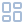<br>
      <b>Widgets</b><br>
      Clocks, a calendar, what is playing, system load. Lay them on the wallpaper by hand, or make one in the widget studio.
    </td>
    <td valign="top">
      <br>
      <b>Setups</b><br>
      A whole desktop look in one item. One press puts it on, <i>As it was</i> takes it off. Share it with a friend as a link or a code.
    </td>
  </tr>
  <tr>
    <td valign="top">
      <br>
      <b>Windows and keys</b><br>
      Windows as tabs, a scrolling strip of windows, every window side by side, rules that open a program where it belongs, zones under Shift.
    </td>
    <td valign="top">
      <br>
      <b>Capture</b><br>
      Screenshots with marks, a recording that zooms where you click, the last minutes on a key. E-mail addresses and keys cover themselves.
    </td>
    <td valign="top">
      <br>
      <b>Presets and desks</b><br>
      Set a program, a project or a game up once: windows on their monitors, the right sound output, the display mode. Close it, and it all goes back.
    </td>
  </tr>
</table>

## Animations

Every style plays on its own card before you add it. The ones below come from
the Workshop and are drawn by the program itself on the same sample desk.

<table>
  <tr>
    <td width="33%">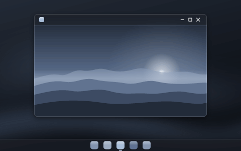</td>
    <td width="33%"></td>
    <td width="33%">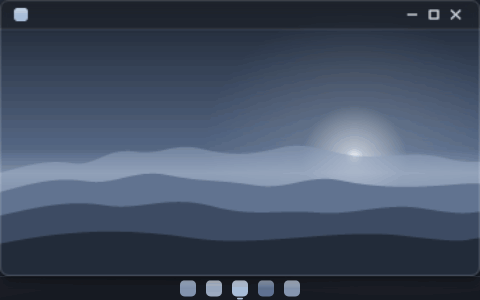</td>
  </tr>
  <tr>
    <td><b>Funnel</b>, minimize</td>
    <td><b>Fold</b>, minimize</td>
    <td><b>Unfurl</b>, maximize</td>
  </tr>
  <tr>
    <td>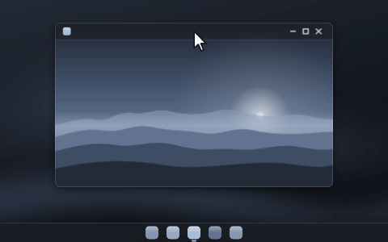</td>
    <td></td>
    <td></td>
  </tr>
  <tr>
    <td><b>Jelly</b>, drag</td>
    <td><b>Tilt</b>, drag</td>
    <td><b>Shatter</b>, close</td>
  </tr>
</table>

The editor shapes length, curve, bounce and each effect's amounts with
sliders, plays the draft on a real window, and slows it down four times when
you want to see it. For a movement nobody has made, the window becomes a grid
of points you drag at key moments.

## The rest of the desk

<table>
  <tr>
    <td width="33%">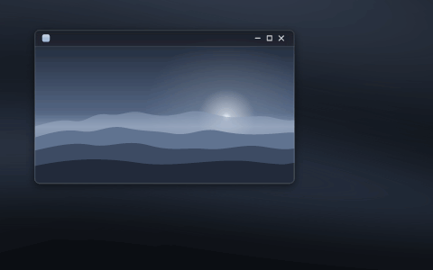</td>
    <td width="33%">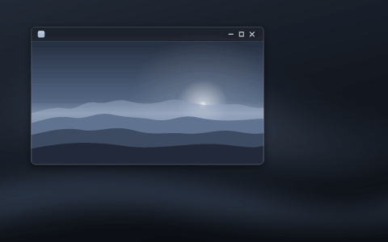</td>
    <td width="33%">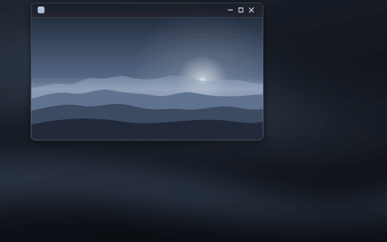</td>
  </tr>
  <tr>
    <td>Glass dock</td>
    <td>Steel dock and clock</td>
    <td>Three islands</td>
  </tr>
  <tr>
    <td>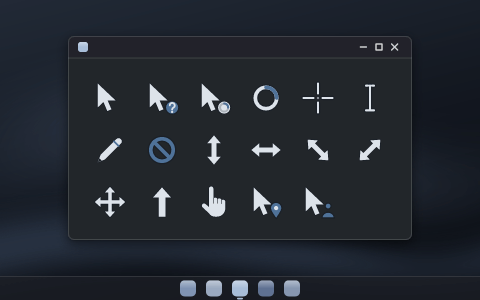</td>
    <td>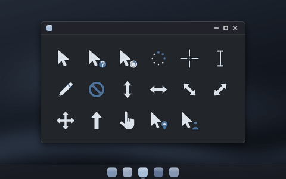</td>
    <td>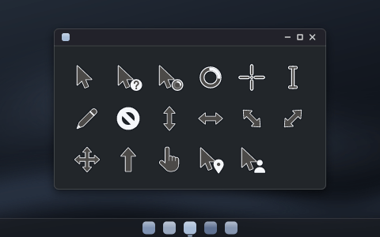</td>
  </tr>
  <tr>
    <td>Steel pointers</td>
    <td>Round pointers</td>
    <td>Accent pointers</td>
  </tr>
  <tr>
    <td>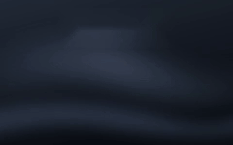</td>
    <td>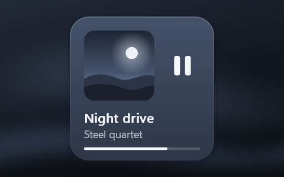</td>
    <td>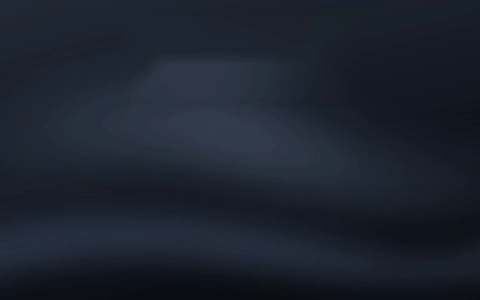</td>
  </tr>
  <tr>
    <td>Clock</td>
    <td>Album</td>
    <td>Glitch, an open widget</td>
  </tr>
</table>

A setup carries all of it at once: styles, the taskbar, pointers, icons, the
island, widgets, theme and glass.

<table>
  <tr>
    <td width="50%">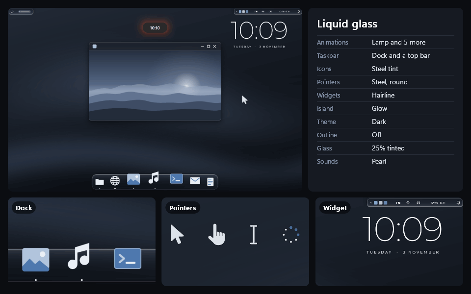</td>
    <td width="50%">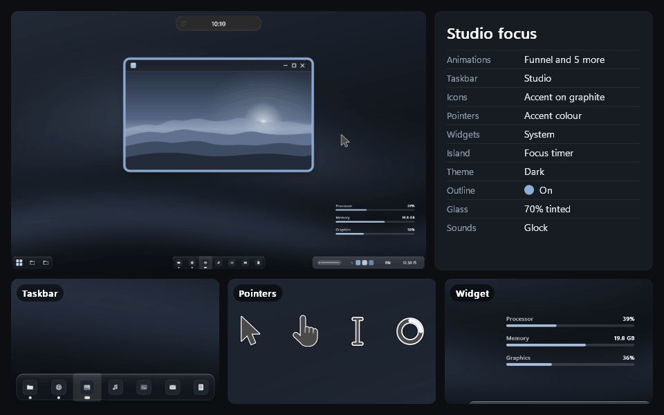</td>
  </tr>
  <tr>
    <td>Liquid glass</td>
    <td>Studio focus</td>
  </tr>
</table>

## Make your own

Styles, taskbar looks, pointer sets, widgets, icon sets, island activities and
setups can all be made by the people who use them and published to the Steam
Workshop from inside the program. None of them is code: a style is a small
JSON file of numbers, a look is a short list of the program's own words, a
pointer set is seventeen pictures. The program checks every file before it
uses it.

[`creators/`](creators/) has the JSON Schemas of every format, worked examples
and the templates, the same files as
[stillwarddisplay.com/creators](https://stillwarddisplay.com/creators/). An
editor that understands JSON Schema offers every field with its range as you
type, and the program checks a file from the command line without opening a
window:

```
stillward-display.exe --check "Calm.motion.json" --gif "Calm.gif"
```

```
ok: "Calm", a minimize style
  minimize: pour in 480 ms
changed on the way in (1):
  minimize.effect.sway: 1.4 → 1
its Workshop card can play it (187 of 5000 bytes)
its Workshop picture: Calm.gif
```

Save the file in your editor, minimize a window, and the new version plays.
Show what you made in [Discussions](https://github.com/ayokiru/stillward-display/discussions).

## Made without injection

<table>
  <tr>
    <td width="50%" valign="top">
      <br>
      <b>Nothing inside other programs</b><br>
      No DLL in another process, no graphics hooks, no keyboard hook. Animations move pictures that Windows already draws, so it is safe to run next to games and anti-cheat.
    </td>
    <td width="50%" valign="top">
      <br>
      <b>Everything goes back</b><br>
      What it changes is written down first and put back when you turn it off, when you quit, and after a crash. Diagnostics → Footprint lists everything it has left on the PC.
    </td>
  </tr>
  <tr>
    <td valign="top">
      <b>Honest hours</b><br>
      Steam counts time only while the program's window is open. In the tray it counts nothing and shows you as playing nothing.
    </td>
    <td valign="top">
      <b>Starts with Windows once</b><br>
      The first start turns that on. Turn it off, and it stays off. Uninstalling from Steam takes back everything it set.
    </td>
  </tr>
</table>

## Get it

Stillward Display is coming soon on Steam, for Windows 10 and 11, in 30
languages. [Wishlist it](https://store.steampowered.com/app/5248400/Stillward_Display/)
to hear the day it comes out.

## Updates

Every build that goes out on Steam is posted here as a
[release](https://github.com/ayokiru/stillward-display/releases) with its notes.
To hear about them, choose **Watch → Custom → Releases** at the top of this
page. The same notes are in [CHANGELOG.md](CHANGELOG.md).

## Bugs and ideas

To report a bug, open Diagnostics in the program, choose **Run the diagnostic**
and then **Copy report**, and paste the report into a
[bug report](https://github.com/ayokiru/stillward-display/issues/new/choose).
Window titles are left out of it. Issues are public, so read it through first,
or send it to support@stillwarddisplay.com instead.

Ideas go to [Ideas](https://github.com/ayokiru/stillward-display/discussions/categories/ideas)
in Discussions: say what gets in your way, and what you do about it now. A
Workshop item that misbehaves has a
[form of its own](https://github.com/ayokiru/stillward-display/issues/new?template=workshop_item.yml).

## Questions

<details>
<summary>Is the source code here?</summary>

<br>

No. Stillward Display is a paid program, and its source is private. This
repository holds the formats people make things in, the pictures, the release
notes and the place to report bugs.

</details>

<details>
<summary>Will an anti-cheat or an antivirus mind it?</summary>

<br>

It is built not to give them a reason. It never loads anything into another
process and never hooks a game's graphics, which is what usually gets programs
like this flagged. It uses documented Windows calls from its own process only.

</details>

<details>
<summary>Do I need two monitors?</summary>

<br>

No. Everything here works on one screen. With more than one, presets and desks
put each program on the monitor you chose, and some styles have a move of
their own between screens.

</details>

<details>
<summary>What happens to my settings if it crashes?</summary>

<br>

They still go back. It writes down what it changes before changing it, and
puts it all back the next time it starts.

</details>

<details>
<summary>Does it need an account or the internet?</summary>

<br>

No account, and nothing is tracked. It works with Steam offline. The Workshop
and Steam Cloud need Steam, the rest of it does not.

</details>

---

<p align="center">
  <sub>Stillward Display is proprietary software · the files in <a href="creators/">creators/</a> are CC0 · icons from <a href="https://lucide.dev">Lucide</a> (ISC) · made by <a href="https://github.com/ayokiru">ayokiru</a></sub>
</p>
